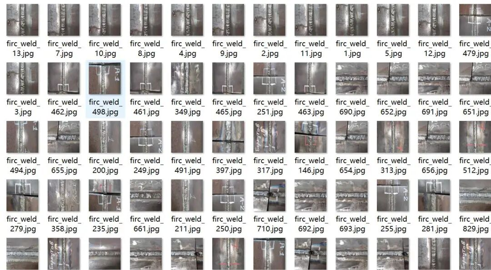
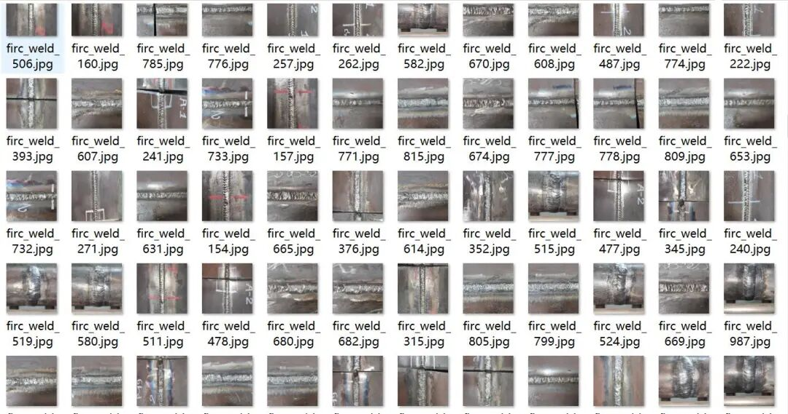
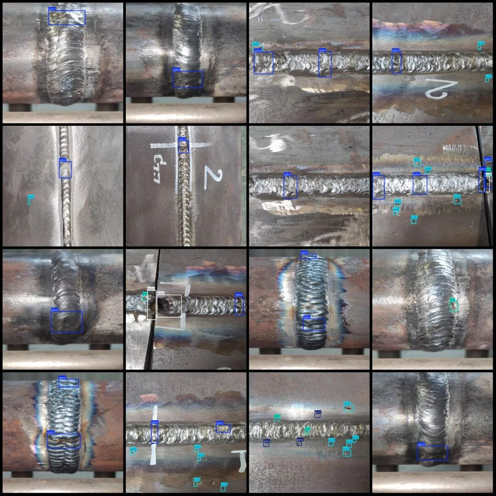

# Detection Dataset for Welding Defects in VOC+YOLO format with 1009 images across 5 categories

Dataset format: Pascal VOC format + YOLO format (txt file without split path, only containing jpg images and corresponding VOC format xml files and yolo format txt files)

Number of images (number of jpg files): 1009

Number of annotations (number of xml files): 1009

Number of annotations (number of txt files): 1009

Label category count: 5

Label category names (note that the order of yolo format categories does not correspond to this, but is based on the labels folder's classes.txt): ["adj", "geo", "int", "non", "pro"]

Number of boxes labeled in each category:

adj (breach) frame count = 1420

geo (pore) frame count = 1063

int (mixed) box count = 388

Non (unwelded) frame count = 205

Pro (weld bump) frame count = 287

Mapping Instructions:

adj → undercut (bite)

geo → porosity (gas pore)

int → inclusion (mixture)

Non → Incomplete Penetration (Unwelded)

pro → overlap (weld bump)

Image resolution: 640x640

Using labelImg:

Annotation rules: Draw a rectangle around the category.

Important Notice: No

Special : This dataset does not guarantee the accuracy of the trained models or weight files.

Image Preview:

Annotation example:

## Payment

Here is a pay link on Stripe ( https://buy.stripe.com/3cs8yP7sY87d0vu9AB ). Please contact me lonlonago@foxmail.com after funding $89, and I will send you a complete data files , thank you!

